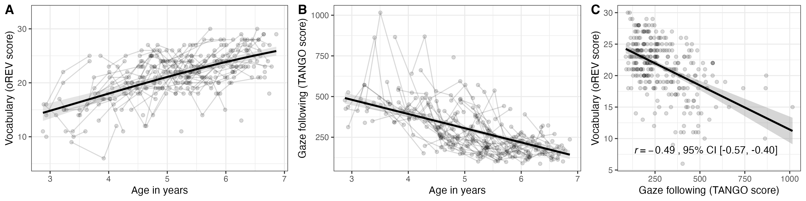
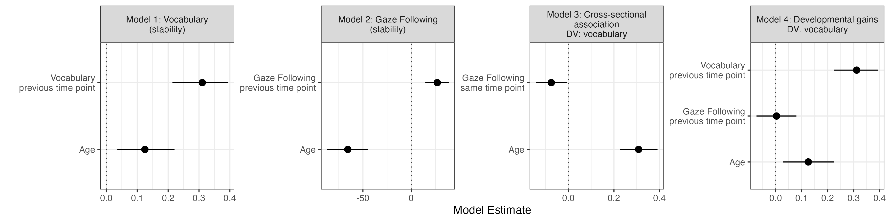

```{r setup, include = FALSE}
library(papaja)
library(tidyverse)
library(brms)
library(ggpubr)
require(cowplot)
```


```{r}
data <- read_csv("../data/clean_data.csv")
```
# Research Highlights

* Individual differences in gaze following and vocabulary were stable across the preschool period.
* More precise gaze following was associated with better receptive vocabulary at the same time point.
* Gaze following did not explain subsequent vocabulary beyond prior vocabulary and age.
* Findings are consistent with a shift in learning strategies with gaze becoming less important from infancy to the preschool years.

# Introduction

Gaze following has been proposed as an important information source during language learning. Infants who follow another person’s gaze more readily tend to have larger vocabularies later in development [@brooks2005development]. A systematic review of the role of eye gaze for language development likewise concluded that there is evidence for associations between early gaze following and later receptive and expressive vocabulary [@ccetinccelik2021eyes; see also @kidd2020individual]. In this paper, we examine the relation between gaze following and vocabulary during the preschool years. 

Gaze acts as a social cue that helps children understand what other people intend to communicate. By following another person’s gaze, children can establish joint attention and use it to infer which object the person is referring to [@tomasello1986joint; @tomasello2008origins]. From this perspective, individual differences in gaze following translate into differences in vocabulary because children differ in how reliably they use another person’s gaze to identify the intended referent. Because gaze is a highly reliable cue, children who follow gaze more precisely may be more likely to look at the relevant object when a word is used, making it easier to learn the word–referent mapping, resulting in larger vocabularies [@yu2007unified].

Language and gaze following develop over different but overlapping timescales. Infants show comprehension of some familiar words by 6–9 months, whereas first spoken words typically emerge around the first birthday [@bergelson2012months; @roy2015predicting]. Vocabulary then grows rapidly during the second and third year and continues to increase through the preschool and early school years, with substantial individual differences in both vocabulary size and growth [@fenson1994variability; @larrc2018modeling; @bornstein2018stability]. Basic gaze following responses can be observed by 3–4 months, although early responses may rely more on head orientation than on eye direction alone [@gredeback2010development; @michel2021effects]. During the first year, infants become better at locating the focus of another person’s attention, begin to engage in joint attention and start to interpret gaze in more mentalistic terms [@moore2008development; @delbianco2019origins]. Gaze following precision continues to improve throughout childhood, with comparatively stable performance from the teenage years onward [@prein2024variation].

Most research on the relation between gaze following and language development has focused on infancy. The systematic review by @ccetinccelik2021eyes, for example, covered studies of children between birth and 24 months. Much less is known about whether individual differences in gaze following remain associated with language development during the preschool years [see @prein2024tango for an exception]. An absence of such a relation might indicate a shift in learning strategies. Importantly, the role of gaze in identifying referents in the moment is not the same as the role of individual differences in gaze following in predicting language development over time. Gaze can remain a useful cue for identifying a speaker’s intended referent, even if children’s relative proficiency in following gaze becomes less informative about how much vocabulary they subsequently learn. One possibility is that, by the preschool years, most children can use gaze reliably enough in everyday communication that differences in gaze following precision explain relatively little variation in subsequent vocabulary development. As children acquire more words, they may increasingly draw on alternative information sources to infer a speaker’s intended meaning [@bohn2026language]. Alternatively, individual differences in gaze following may continue to be associated with vocabulary development beyond infancy. For example, @prein2024variation studied gaze following across the lifespan and found that a plateau in performance was reached only in school age. Distinguishing between these possibilities therefore offers insights into the developing structure of the language learning process.

# The current study

To investigate the relation between gaze following and vocabulary beyond infancy, we conducted a longitudinal study with preschool children. The study included four testing time points, equally spaced across nine month. At each time point, children completed a gaze following [@prein2025measuring; @prein2024tango] and a receptive vocabulary task [@bohn2024orev; @bohn2026orevvn]. Both tasks have previoulsy shown to be relaible and valid measures of the focal constructs in children.

A prerequisite for examining associations between two constructs is to establish whether individual differences in each construct are stable over time. If this is not the case, it is unlikely that one construct -- as measured -- continuously influences the other. Language abilities show relatively stable individual differences from infancy into adulthood [@bornstein2018stability; @kidd2020individual]. The stability of individual differences in gaze following has mostly been investigated during infancy, with mixed results and at best moderate correlations between repeated assessments within the first two years of life [@astor2020social; @zeng2023social]. Studies on the same topic for preschool children are notably absent. Thus, the first goal of this study is to determine whether there are stable individual differences in gaze following and vocabulary across the age range considered. 

The second goal was to investigate concurrent and prospective associations between gaze following and vocabulary. Specifically, we examined whether children with more precise gaze following had larger vocabularies at the same time point, and whether gaze-following predicted vocabulary at the next time point after accounting for earlier vocabulary and age. This last question critically investigates whether the predictive link between gaze following and vocabulary reported in infancy persists throughout the preschool years. 

# Methods

All data and analysis scripts are available in a public repository [masked for peer review]. The paper does not contain content generated by artificial intelligence tools. 

## Participants
```{r}
dem <- data |> 
  group_by(tp) |> 
  distinct(id, .keep_all = T) |> 
  summarise(
    n = n(), 
    fem = sum(sex == "f"), 
    mage = mean(age), 
    minage = min(age),
    maxage = max(age), 
    diftp = mean(dif, na.rm = T),
    sddiftp = sd(dif, na.rm = T)
  )

ntps <- data |> 
  group_by(id) |> 
  summarise(ntp = n()) |> 
  group_by(ntp) |> 
  summarise(n = n())
```


A total of N = `r n_distinct(data$id)` children (`r n_distinct(data$id[data$sex =="f"])` female) participated in the study. The study had four testing time points and took place in children's kindergarten. Mean age at the first time point was `r round(dem |> filter(tp ==1) |> pull(mage),2)` (range: `r round(dem |> filter(tp ==1) |> pull(minage),2)` to `r round(dem |> filter(tp ==1) |> pull(maxage),2)`). Not all children participated at all time points; `r ntps |> filter(ntp ==1) |> pull(n)` participated only at one time point, `r ntps |> filter(ntp ==2) |> pull(n)` at two, `r ntps |> filter(ntp ==3) |> pull(n)` at three, and `r ntps |> filter(ntp ==4) |> pull(n)` at all four. The main reason for missing a time point was absence on the day of testing, usually due to sickness. As a consequence, time point 1 had `r dem |> filter(tp ==1) |> pull(n)` participants, time point 2 had `r dem |> filter(tp ==2) |> pull(n)`, time point 3 had `r dem |> filter(tp ==3) |> pull(n)`, and time point 4 had `r dem |> filter(tp ==4) |> pull(n)`. Children lived in Lüneburg, a city in northern Germany with ~ 70,000 inhabitants and were recruited via a database of children whose parents had consented to participating in studies of child development. Detailed information on the socioeconomic status of participating families was not collected. However, given the characteristics of the local population, the sample may be skewed towards families with relatively high levels of education and socioeconomic status. German was the only language for 101 children, eleven children were exposed to an additional language besides German, and for four children, information on language exposure was missing. Data collection started in May 2025 and lasted until September 2026. The study adhered to the Helsinki declaration and did not involve deception, invasive or otherwise ethically problematic techniques. According to National jurisdiction, it therefore did require a separate vote by a local Institutional Review Board (see regulations on freedom of research in the German Constitution (§ 5 (3)), and the German University Law (§ 22)).Data collection using the same tasks and procedures described below was previously approved by [masked for peer review].

## Material

At each time point, children completed the same gaze following and receptive vocabulary tasks. Both tasks are implemented as interactive picture books on a website and were administered in a web browser via touchscreen tablets (Microsoft Surface Pro X, 13'' screen). Children responded by touching pictures or locations on the screen. 

The gaze following task was the German version of the TANGO-CC [@prein2025measuring; @prein2024tango]. The TANGO has been developed to measure individual differences in gaze following precision in children and adults. It has been used to study gaze following across the lifespan and across diverse cultural settings [@bohn2026universal; @prein2024variation]. Previous work showed that it is highly reliable and valid [@prein2025measuring; @prein2024tango]. The task is set up as a balloon finding game. Children see an agent in a window whose gaze is following the trajectory of a balloon that is falling to the ground behind a hedge. On training trials, to familiarize them with the goal and procedure of the game, there is no hedge and children see the balloon fall to the ground. On test trials, children do not see the trajectory of the balloon but have to locate it by using the agent's gaze. The dependent measure is imprecision, that is, the absolute distance (in pixel) between where the balloon landed and where children indicated (via touch on the hedge) it landed. Because it is a measure of error, lower values mean better performance. There was no differential feedback, that is, the true location of the balloon was not revealed. Children completed four training trials and 15 test trials at each time point; the order of trials was the same for all children and at all time points. For a detailed description of the task and its psychometric properties, see @prein2025measuring and @prein2024tango. 

The receptive vocabulary task was the oREV-VN [@bohn2026orevvn], an extension of the oREV [@bohn2024orev] that includes verbs and nouns. It is a  picture matching task, that is, on each trial, children saw four pictures and were asked by a pre-recorded voice to select one of them. The oREV-VN includes 22 nouns and 11 verbs. It was developed using Item Response Theory and has been found to have excellent psychometric properties [see @bohn2024orev; @bohn2026orevvn]. The dependent variable was the sum of correct trials. There is no differential feedback. Children completed 33 trials at each time point; the order of trials was the same for all children and at all time points. 

## Procedure

Children were tested individually in a quiet room or area in their kindergarten. They first completed the oREV-VN, followed by the TANGO. Testing sessions were planned to take place approximately 13 weeks apart for each child. In practice, the intervals varied. The mean interval between the first and second time point was `r round(dem |> filter(tp ==2) |> pull(diftp),2)` (*SD* = `r round(dem |> filter(tp ==2) |> pull(sddiftp),2)`), between the second and third it was `r round(dem |> filter(tp ==3) |> pull(diftp),2)` (*SD* = `r round(dem |> filter(tp ==3) |> pull(sddiftp),2)`), and between the third and fourth it was `r round(dem |> filter(tp ==4) |> pull(diftp),2)` (*SD* = `r round(dem |> filter(tp ==4) |> pull(sddiftp),2)`). 

## Data analysis

Data were analysed using Bayesian multilevel regression models fit in `R` via the `brms` package [@burkner2017brms]. We constructed four models to answer our research questions. All models used default priors. Numerical predictor variables were scaled (*M* = 0, *SD* = 1) before entering into the model to facilitate model fitting and comparisons across models.

The first model focused on the stability of individual differences in receptive vocabulary. The data was modeled as a binomial distribution so that the sum of correct trials (conditional on the overall number of trials) was predicted by age and the performance in the vocabulary task at the previous time point. The model also included a random intercept term for id. Model formula in `brms` notation: `orev | trials(33) ~ orev_lag + age + (1 | id)` (the term `trials(33)` reflects the number of trials in the oREV, which was the same for all children). A total of 156 observations from 80 children entered the model. 

As noted above, not all children completed all time points. If a child missed a time point, this was treated as missing data instead of using the data from the last available time point as a predictor. For example, if a child participated at time point 1, 3 and 4 (missing time point 2), they did not contribute data to the link between time point 1 and 2 and 2 and 3. The same approach was used for all longitudinal models (model one, two and four).  


```{r}
# md1 <- data |> 
#   mutate(z_orev_lag = scale(orev_lag), 
#          z_age = scale(age))
# 
# orev_stability <- brm(
#   orev | trials(33) ~ z_orev_lag + z_age + (1 | id),
#   family = binomial(link = "logit"),
#   data = md1,
#   chains = 4,
#   cores = 4,
#   iter = 4000,
#   warmup = 2000,
#   seed = 123
# )
# 
# saveRDS(orev_stability, "../saves/orev_stability.rds")
orev_stability <- readRDS("../saves/orev_stability.rds")
```

The second model focused on the stability of individual differences in gaze following. Here, the average imprecision (in pixel) across all test trials was used as the dependent variable which was modeled as a skew normal. The model included gaze following performance at the previous time point and age as fixed effects and id as a random effect. Model formula in `brms` notation: `tango ~ tango_lag + age + (1 | id)`. A total of 160 observations from 80 children entered the model. 

```{r}
# md2 <- data |> 
#   mutate(z_tango_lag = scale(tango_lag), 
#          z_age = scale(age))
# 
# tango_stability <- brm(
#   tango ~ z_tango_lag + z_age + (1 | id),
#   family = skew_normal(),
#   data = md2,
#   chains = 4,
#   cores = 4,
#   iter = 4000,
#   warmup = 2000,
#   seed = 123
# )
# 
# saveRDS(tango_stability, "../saves/tango_stability.rds")
tango_stability <- readRDS("../saves/tango_stability.rds")
```

The third model focused on the cross-sectional association between gaze following and receptive vocabulary. The dependent variable was again the sum of correct trials in the vocabulary task (modeled as a binomial distribution), which was predicted by gaze following at the same time point and age. The model also included a random intercept for id. Model formula in `brms` notation: `orev | trials(33) ~ tango + age + (1 | id)`. A total of 301 observations from 115 children entered the model. 

```{r}
# md3 <- data |> 
#   mutate(z_tango = scale(tango), 
#          z_age = scale(age))
# 
# cross_sectional <- brm(
#   orev | trials(33) ~ z_tango + z_age + (1 | id),
#   family = binomial(link = "logit"),
#   data = md3,
#   chains = 4,
#   cores = 4,
#   iter = 4000,
#   warmup = 2000,
#   seed = 123
# )
# 
# saveRDS(cross_sectional, "../saves/cross_sectional.rds")
cross_sectional <- readRDS("../saves/cross_sectional.rds")
```
Finally, the fourth model focused on whether gaze following at the previous time point predicted subsequent vocabulary over and above age and prior vocabulary. Once again, the dependent variable was the sum of correct trials in the vocabulary task (modeled as a binomial distribution), which was predicted by vocabulary skills and gaze following at the previous time point as well as age. The model also included a random intercept for id. Model formula in `brms` notation: `orev | trials(33) ~ tango_lag + orev_lag + age + (1 | id)`. A total of 156 observations from 80 children entered the model.

```{r}
# md4 <- data |> 
#   mutate(z_tango_lag = scale(tango_lag), 
#          z_orev_lag = scale(orev_lag), 
#          z_age = scale(age))
# 
# longitudinal <- brm(
#   orev | trials(33) ~ z_tango_lag + z_orev_lag + z_age + (1 | id),
#   family = binomial(link = "logit"),
#   data = md4,
#   chains = 4,
#   cores = 4,
#   iter = 4000,
#   warmup = 2000,
#   seed = 123
# )
# 
# saveRDS(longitudinal, "../saves/longitudinal.rds")
longitudinal <- readRDS("../saves/longitudinal.rds")
```

# Results

```{r}
# orev_age_plot <- brm(
#   orev | trials(33) ~ z_age + (1 | id),
#   family = binomial(link = "logit"),
#   data = md1,
#   chains = 4,
#   cores = 4,
#   iter = 4000,
#   warmup = 2000,
#   seed = 123
# )
# 
# ndata1 <- md1%>%
#   distinct(z_age, age) |> 
#   mutate(orev_n = 33)
# 
# post1 <- fitted(orev_age_plot, newdata = ndata1, re_formula = NA)%>%
#   as_tibble() %>%
#   bind_cols(ndata1)
# 
# 
# tango_age_plot <- brm(
#   tango ~ z_age + (1 | id),
#   family = skew_normal(),
#   data = md2,
#   chains = 4,
#   cores = 4,
#   iter = 4000,
#   warmup = 2000,
#   seed = 123
# )
# 
# ndata2 <- md2%>%
#   distinct(z_age, age)
# 
# post2 <- fitted(tango_age_plot, newdata = ndata2, re_formula = NA)%>%
#   as_tibble() %>%
#   bind_cols(ndata2)
# 
# 
model_summaries <- bind_rows(
fixef(orev_stability) |> as_tibble(rownames = "pred") |> mutate(model = "Model 1: Vocabulary\n(stability)"),
fixef(tango_stability) |> as_tibble(rownames = "pred")|> mutate(model = "Model 2: Gaze Following\n(stability)"),
fixef(cross_sectional) |> as_tibble(rownames = "pred")|> mutate(model = "Model 3: Cross-sectional\nassociation\nDV: vocabulary"),
fixef(longitudinal) |> as_tibble(rownames = "pred")|> mutate(model = "Model 4: Developmental gains\nDV: vocabulary")
) |>
  filter(pred != "Intercept") |>
  mutate(pred = recode(pred,
                       z_orev_lag = "Vocabulary\nprevious time point",
                       z_tango_lag = "Gaze Following\nprevious time point",
                       z_orev = "Vocabulary\nsame time point",
                       z_tango = "Gaze Following\nsame time point",
                       z_age = "Age"))
```


```{r}
# pos <- ggplot()+
#   geom_point(data = data, aes(x = age, y = orev), alpha = 0.15)+
#   geom_line(data = data, aes(x = age, y = orev, group = id), alpha = .15)+
#   geom_smooth(data = post1, aes(x = age, y = Estimate, ymin = Q2.5, ymax = Q97.5), stat = "identity", alpha = .25, col = "black")+
#   theme_bw()+
#   ylim(5,33)+
#   labs(x = "Age in years", y="Vocabulary (oREV score)")+
#   theme(
#     #legend.position = c(0.8, 0.15), 
#     legend.background = element_rect(colour = "black", size = 0.5, linetype = "solid"))
# 
# pts <- ggplot()+
#   geom_point(data = data, aes(x = age, y = tango), alpha = 0.15)+
#   geom_line(data = data, aes(x = age, y = tango, group = id), alpha = .15)+
#   geom_smooth(data = post2, aes(x = age, y = Estimate, ymin = Q2.5, ymax = Q97.5), stat = "identity", alpha = .25, col = "black")+
#   theme_bw()+
#   labs(x = "Age in years", y="Gaze following (TANGO score)")+
#   theme(
#     #legend.position = c(0.8, 0.15), 
#     legend.background = element_rect(colour = "black", size = 0.5, linetype = "solid"))
# 
# pc <- ggplot(data = data, aes(x = tango, y = orev))+
#   geom_point(alpha = 0.15)+
#   geom_smooth(method ="lm", col = "black")+
#   stat_cor(aes(label = paste(after_stat(r.label), after_stat(conf.int.label), sep = "~`,`~")),r.accuracy = 0.01, cor.coef.name = "r", label.x.npc = 0.05, label.y.npc = 0.1)+
#   theme_bw()+
#   labs(x ="Gaze following (TANGO score)", y = "Vocabulary (oREV score)")+
#   theme(
#     #legend.position = c(0.8, 0.15), 
#     legend.background = element_rect(colour = "black", size = 0.5, linetype = "solid"))
```

```{r}
 # plot_grid(pos, pts, pc, rel_widths = c(1,1,0.75), labels = c("A", "B", "C"), nrow = 1, axis = "tb")
 # ggsave("../visuals/fig1.png", width = 12, height = 3)
```
(ref:figlab1) Data overview. Panel A) shows predicted developmental trajectories (with 95% CrI) for the vocabulary task (oREV). Panel B) shows predicted developmental trajectories (with 95% CrI) for the gaze following task (TANGO) Note: smaller values mean better performance. In both A) and B), points show the aggregated data per child and time point, transparent lines connect data points from the same child. Developmental trajectories are based on models that predicted performance only by age. Panel C) shows the zero-order, cross-sectional correlation between vocabulary and gaze following.  

```{r fig1, include = T, fig.align = "center", fig.cap = "(ref:figlab1)", out.width="100%"}

```
Figure \@ref(fig:fig1) gives an overview of the descriptive results. Both vocabulary and gaze following show substantial developmental improvement with age. Furthermore, there is a large negative zero-order, cross-sectional correlation between the two variables in that more accurate gaze following (less imprecision) is associated with higher vocabulary. 

Figure \@ref(fig:fig2) gives an overview of the model results. The first model showed that individual differences in vocabulary are stable even when accounting for age. That is, performance at the previous time point had a large positive effect on performance ($\beta$ = `r round(fixef(orev_stability) |> as_tibble(rownames = "pred") |> filter(pred =="z_orev_lag") |> pull(Estimate),2)`, 95% CrI [`r round(fixef(orev_stability) |> as_tibble(rownames = "pred") |> filter(pred =="z_orev_lag") |> pull(Q2.5),2)`, `r round(fixef(orev_stability) |> as_tibble(rownames = "pred") |> filter(pred =="z_orev_lag") |> pull(Q97.5),2)`]), which was also larger than the effect of age on performance ($\beta$ = `r round(fixef(orev_stability) |> as_tibble(rownames = "pred") |> filter(pred =="z_age") |> pull(Estimate),2)`, 95% CrI [`r round(fixef(orev_stability) |> as_tibble(rownames = "pred") |> filter(pred =="z_age") |> pull(Q2.5),2)`, `r round(fixef(orev_stability) |> as_tibble(rownames = "pred") |> filter(pred =="z_age") |> pull(Q97.5),2)`]). The second model showed that individual differences were also stable for gaze following, however, the absolute effect of performance at the previous time point ($\beta$ = `r round(fixef(tango_stability) |> as_tibble(rownames = "pred") |> filter(pred =="z_tango_lag") |> pull(Estimate),2)`, 95% CrI [`r round(fixef(tango_stability) |> as_tibble(rownames = "pred") |> filter(pred =="z_tango_lag") |> pull(Q2.5),2)`, `r round(fixef(tango_stability) |> as_tibble(rownames = "pred") |> filter(pred =="z_tango_lag") |> pull(Q97.5),2)`]) was smaller compared to the effect of age ($\beta$ = `r round(fixef(tango_stability) |> as_tibble(rownames = "pred") |> filter(pred =="z_age") |> pull(Estimate),2)`, 95% CrI [`r round(fixef(tango_stability) |> as_tibble(rownames = "pred") |> filter(pred =="z_age") |> pull(Q2.5),2)`, `r round(fixef(tango_stability) |> as_tibble(rownames = "pred") |> filter(pred =="z_age") |> pull(Q97.5),2)`]). Note that the positive effect of performance at the previous time point means that children with larger imprecision at `t-1` also had large imprecision at `t`, while the negative effect of age means that older children had lower imprecision. Taken together, both tasks showed stable, age-independent individual differences. 

In the third, cross-sectional model, we found that gaze following had a small but significant (i.e., 95% CrI not overlapping with 0) effect on vocabulary ($\beta$ = `r round(fixef(cross_sectional) |> as_tibble(rownames = "pred") |> filter(pred =="z_tango") |> pull(Estimate),2)`, 95% CrI [`r round(fixef(cross_sectional) |> as_tibble(rownames = "pred") |> filter(pred =="z_tango") |> pull(Q2.5),2)`, `r round(fixef(cross_sectional) |> as_tibble(rownames = "pred") |> filter(pred =="z_tango") |> pull(Q97.5),2)`]). The negative effect suggests that children with lower imprecision in gaze following had higher vocabularies. Finally, in the fourth model investigating developmental gains in vocabulary, we again found substantial effects of vocabulary at the previous time point ($\beta$ = `r round(fixef(longitudinal) |> as_tibble(rownames = "pred") |> filter(pred =="z_orev_lag") |> pull(Estimate),2)`, 95% CrI [`r round(fixef(longitudinal) |> as_tibble(rownames = "pred") |> filter(pred =="z_orev_lag") |> pull(Q2.5),2)`, `r round(fixef(longitudinal) |> as_tibble(rownames = "pred") |> filter(pred =="z_orev_lag") |> pull(Q97.5),2)`]) and age ($\beta$ = `r round(fixef(longitudinal) |> as_tibble(rownames = "pred") |> filter(pred =="z_age") |> pull(Estimate),2)`, 95% CrI [`r round(fixef(longitudinal) |> as_tibble(rownames = "pred") |> filter(pred =="z_age") |> pull(Q2.5),2)`, `r round(fixef(longitudinal) |> as_tibble(rownames = "pred") |> filter(pred =="z_age") |> pull(Q97.5),2)`]), however, the effect of performance in the gaze following task at the previous time point was essentially zero ($\beta$ = `r round(fixef(longitudinal) |> as_tibble(rownames = "pred") |> filter(pred =="z_tango_lag") |> pull(Estimate),2)`, 95% CrI [`r round(fixef(longitudinal) |> as_tibble(rownames = "pred") |> filter(pred =="z_tango_lag") |> pull(Q2.5),2)`, `r round(fixef(longitudinal) |> as_tibble(rownames = "pred") |> filter(pred =="z_tango_lag") |> pull(Q97.5),2)`]). Thus, we found no clear evidence that prior gaze-following explained subsequent vocabulary beyond prior vocabulary and age. 

```{r}
# model_summaries |>
#   ggplot()+
#   geom_vline(xintercept = 0, lty = 3, alpha = 0.75)+
#   geom_pointrange(aes(y = pred, x = Estimate, xmin = `Q2.5`, xmax = Q97.5))+
#   facet_wrap(~model, scales = "free", nrow = 1)+
#   labs(x = "Model Estimate", y = "")+
#   theme_bw()
# ggsave("../visuals/fig2.png", width = 12, height = 3)
```

(ref:figlab2) Model estimates. Points show mean estimates with 95% CrI for focal predictors from the four models. Intercept terms have been omitted for clarity. Note that for gaze following, lower values mean better performance. All predictors were scaled to *M* = 0 and *SD* = 1 to facilitate comparisons.   

```{r fig2, include = T, fig.align = "center", fig.cap = "(ref:figlab2)", out.width="100%"}

```

# Discussion

This longitudinal study investigated the relation between gaze following and language beyond infancy. The results showed that both gaze following and receptive vocabulary show stable individual differences across the preschool period. Furthermore, more precise gaze following was associated with better vocabulary cross-sectionally. However, there was no longitudinal effect of gaze following on vocabulary, meaning that better gaze following at the previous time point did not predict vocabulary at the next time point.

Both tasks showed stable individual differences in that performance at the previous time point predicted performance at the next. For language, this finding replicates a well-known pattern that extends beyond the preschool years [@bornstein2018stability; @kidd2020individual]. For gaze following, we are not aware of any other study investigating this question beyond infancy. @astor2020social found moderate stability of individual differences throughout infancy. @zeng2023social, on the other hand, found less systematic associations in children from six to 14 months of age: individual differences were significantly correlated from six to 14 months, but not from six to eight or eight to 14 months. The present study showed stable individual differences throughout the preschool years. Taken together, these results provide an important foundation for investigating the sources of individual differences as well as their relation to one another. If there were no stable individual differences within a construct, it would make little sense to ask whether individual differences in this construct relate to individual differences in other constructs.

We found a large cross-sectional, zero-order correlation between gaze following and vocabulary. When accounting for age and repeated measurements of the same individuals, we still found a substantial relation, although the effect was small, especially in comparison to the effect of age. This suggests that the large zero-order correlation is partly explained by children getting better with age in both tasks (see Figure \@ref(fig:fig1)): older children perform better in both tasks without there being much shared variation between the constructs. The results reported here nonetheless show that individual differences covary over and above what would be expected based on general developmental gains. This finding is in line with cross-sectional associations that have been found for infants [@slaughter2003emergence]. A process that could explain this association is that both gaze and words can be used to establish reference in communication. That is, both are used by speakers to express an intention to communicate about something [@bohn2026language]. Children may vary in how much they rely on these information sources, so that children who often consider them jointly are more sensitive to both of them. Because gaze and language are also used independently of one another, the association is not very strong. More generally, the cross-sectional association suggests that individual differences in language skills and the ability to use social information are related, even when accounting for age. 

A cross-sectional association does not necessarily mean that individual differences in gaze following directly contribute to subsequent vocabulary growth. Such a pattern emerged in the final analysis where there was no effect of gaze following on vocabulary growth. When accounting for earlier vocabulary and age, individual differences in gaze following at the previous time point had no effect on vocabulary at the next time point. As mentioned above, this is not due to a lack of stable individual differences in gaze following. The absence of a longitudinal link contrasts with the infancy literature, where such associations have been reported [@brooks2005development; @de2011dyadic; @brooks2015connecting; see @kidd2020individual for a review]. However, the review by @ccetinccelik2021eyes highlights that many studies combine gaze with other ostensive or joint-attentional cues (e.g., head direction), making it difficult to isolate the contribution of gaze itself. The design reported here therefore presents a particularly strong test for the association between gaze following and vocabulary. 

The absence of an effect of gaze following on vocabulary growth is consistent with a shift in children's learning strategies. At the onset of language learning, directly observable nonverbal cues such as gaze and pointing might be particularly important to "break the language barrier" and infer the meaning of unknown words by inferring the speaker's intention [@hollich2000what]. Gaze may support learning by directing children's attention toward relevant objects and facilitating the processing of object properties, which in turn can support the formation of word–object mappings [@okumura2017individual]. Over time, and alongside developmental change in other socio-cognitive domains, children may use other information sources, such as context and common ground [@clark2015common; @bohn2018common; @sullivan2019discourse], semantic knowledge of other words [@thom2009more; @yu2008statistical], or syntactic abilities [@babineau2024syntactic], to learn language instead. Language learning is an integrative process in which children combine multiple information sources to infer what speakers mean [@bohn2026language]. The present findings are consistent with the possibility that the relative importance of these sources changes over the course of development. However, the absence of a longitudinal association does not mean that gaze is no longer important for language learning. Gaze may continue to support word learning in the moment, even if individual differences in gaze following precision no longer predict differences in vocabulary growth [@lee2023dynamic].

In order to generalize the results reported here, cross-linguistic and cross-cultural studies will be necessary. It is conceivable that in contexts other than Germany, gaze continues to have an important impact on language learning. The use of gaze and other social cues may vary across communicative environments, and the relation between gaze following and language development may therefore differ across populations. Fortunately, the tasks used in this study have been translated and adapted to different languages, which would make such an endeavor feasible [@prein2025measuring; @bohn2026orevvn]. Future studies could investigate whether the stability of individual differences in gaze following and its association with vocabulary are similar across cultural and linguistic contexts.

Taken together, the study presented here suggests a shift in the role of gaze as a source of information for language learning. Despite stable individual differences in both gaze following and vocabulary, and systematic covariation between the two, gaze following did not predict vocabulary growth. These findings support the view that language learning is an integrative process that relies on multiple information sources [@bohn2026language; @yu2007unified; @bohn2021young; @hollich2000what]. Rather than becoming irrelevant, gaze may become one of several sources that children use flexibly as their linguistic and socio-cognitive abilities develop.

\newpage

# References

::: {#refs custom-style="Bibliography"}
:::
